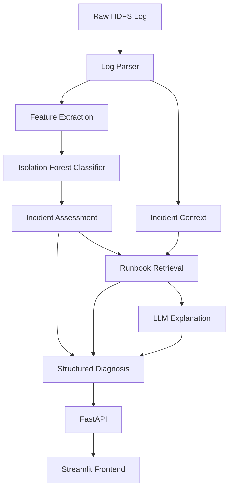

# OpsPilot AI — Agentic Incident Diagnosis & Resolution Copilot

An AI-powered incident diagnosis system that analyzes system logs, detects anomalous behavior, retrieves relevant troubleshooting runbooks, and generates evidence-based incident explanations.

OpsPilot AI combines machine learning, log processing, retrieval-based troubleshooting, rule-based assessment, and large language models to help engineers investigate unusual system activity.

> **Project status:** Local Docker deployment configured. Verify container health, test results, and public deployment status before claiming production readiness.

---

## Table of Contents

- [Overview](#overview)
- [Problem Statement](#problem-statement)
- [Key Features](#key-features)
- [Architecture](#architecture)
- [Technology Stack](#technology-stack)
- [Project Structure](#project-structure)
- [Dataset](#dataset)
- [Machine Learning Pipeline](#machine-learning-pipeline)
- [Incident Diagnosis Workflow](#incident-diagnosis-workflow)
- [API Documentation](#api-documentation)
- [Installation and Setup](#installation-and-setup)
- [Docker Deployment](#docker-deployment)
- [Environment Variables](#environment-variables)
- [Testing](#testing)
- [Limitations](#limitations)
- [Future Improvements](#future-improvements)
- [Security](#security)
- [Author](#author)

---

## Overview

OpsPilot AI is a diagnostic copilot for investigating unusual system log records.

The system accepts a raw log line, parses its fields, extracts numerical features, and uses an Isolation Forest model to flag unusual records. It then retrieves relevant troubleshooting runbooks, produces a rule-based incident assessment, and can request an LLM-generated explanation.

The application exposes its functionality through a FastAPI backend and a Streamlit frontend.

### What it does

1. Accepts raw system log records.
2. Parses structured information from HDFS-style logs.
3. Extracts features for anomaly detection.
4. Uses a trained Isolation Forest model to flag unusual records.
5. Retrieves relevant troubleshooting documentation.
6. Produces a structured incident assessment.
7. Generates an LLM explanation when the configured provider is available.
8. Exposes the workflow through REST API endpoints and a web interface.

---

## Problem Statement

System logs contain large volumes of operational information. Investigating unusual records manually can be time-consuming, particularly when engineers need to correlate log messages with troubleshooting documentation.

OpsPilot AI aims to simplify the initial investigation process by combining automated anomaly detection with contextual troubleshooting guidance.

The system is designed to assist engineers, not replace human incident responders. An anomaly flag is a signal for investigation, not proof of a confirmed production incident or root cause.

---

## Key Features

### Machine Learning
- Isolation Forest-based anomaly detection.
- Feature extraction from HDFS-style log messages.
- Reusable model artifacts for inference.
- Structured anomaly prediction results.

### Log Processing
- Parses timestamps, process identifiers, log levels, components, and messages.
- Extracts message-based numerical features.
- Handles log records through a reusable parsing service.

### Troubleshooting Retrieval
- Loads troubleshooting documents from a local runbook directory.
- Retrieves candidate runbooks based on query relevance.
- Returns supporting troubleshooting guidance when matches are available.

### Incident Assessment
- Produces a structured incident summary.
- Includes anomaly scores and relevant diagnostic evidence.
- Provides recommended investigation steps.
- Represents unknown root causes explicitly rather than inventing them.

### LLM-Powered Explanation
- Generates a natural-language explanation from the available evidence.
- Can include observations, possible interpretations, recommended checks, and uncertainty.
- Supports graceful fallback when the LLM provider is unavailable.

### API and Interface
- FastAPI REST endpoints.
- Interactive API documentation with Swagger UI.
- Streamlit interface for submitting logs and reviewing diagnosis results.
- Docker Compose configuration for running the application services.

---

## Architecture



The exact execution order is controlled by the workflow implementation. The diagram illustrates the major components and information flow.

### Component Responsibilities

| Component | Responsibility |
|---|---|
| Log Parser | Parses raw log lines into structured fields |
| Feature Extractor | Converts log information into model features |
| Anomaly Classifier | Flags records that appear unusual |
| Runbook Retriever | Searches local troubleshooting documents |
| Incident Assessor | Builds a structured, rule-based assessment |
| LLM Explainer | Generates a natural-language explanation |
| FastAPI | Exposes prediction and diagnosis endpoints |
| Streamlit | Provides the interactive user interface |
| Docker Compose | Coordinates backend and frontend containers |

---

## Technology Stack

| Category | Technologies |
|---|---|
| Language | Python |
| Data Processing | pandas, NumPy |
| Machine Learning | scikit-learn, Isolation Forest |
| Model Persistence | joblib |
| Backend | FastAPI, Uvicorn |
| Validation | Pydantic |
| Frontend | Streamlit |
| LLM Integration | LangChain Groq integration |
| Testing | pytest |
| Containers | Docker, Docker Compose |
| Version Control | Git, GitHub |

---

## Project Structure

```text
OpsPilot-AI/
├── app/
│   ├── main.py
│   ├── api/
│   │   ├── incidents.py
│   │   └── health.py
│   ├── schemas/
│   │   └── incident.py
│   ├── services/
│   │   ├── log_parser.py
│   │   ├── classifier.py
│   │   ├── rag_service.py
│   │   ├── incident_assessor.py
│   │   └── llm_explainer.py
│   └── agents/
│       ├── workflow.py
│       └── tools.py
├── ml/
│   ├── data/
│   ├── artifacts/
│   ├── preprocess.py
│   ├── features.py
│   ├── train.py
│   └── evaluate.py
├── knowledge_base/
│   ├── runbooks/
│   └── ingestion.py
├── frontend/
│   └── streamlit_app.py
├── tests/
├── evaluation/
├── Dockerfile
├── docker-compose.yml
├── requirements.txt
├── .env.example
├── .gitignore
├── .dockerignore
└── README.md
```

Some generated artifacts and local datasets may be excluded from version control. The actual directory contents may differ slightly as the project evolves.

---

## Dataset

The project was developed using HDFS-style system log data from the Log Data for Anomaly Detection dataset.

Example log record:

```text
081109 203518 143 INFO dfs.DataNode$DataXceiver: Receiving block blk_-1608999687919862906 src: /10.250.19.102:54106 dest: /10.250.19.102:50010
```

The parser extracts fields such as:

- Date and time
- Process identifier
- Log level
- Component
- Message

### Data Handling

The raw dataset can be large. Keep the original log file locally or obtain it from its original source rather than committing it to GitHub.

The expected local path for the raw file is:

```text
ml/data/sorted.log
```

The dataset should be excluded from Git using `.gitignore`.

---

## Machine Learning Pipeline

The ML pipeline converts raw log records into numerical features and trains an unsupervised anomaly detector.

### 1. Preprocessing

`ml/preprocess.py`

- Reads the raw log file incrementally.
- Parses log records.
- Writes structured data to `ml/data/parsed_hdfs_logs.csv`.

### 2. Feature Extraction

`ml/features.py`

Extracts features such as:

- Message length
- Token count
- Digit count
- Presence of error-related keywords
- Presence of block identifiers
- Presence of IP addresses

The generated feature dataset is saved to:

```text
ml/data/log_features.csv
```

### 3. Model Training

`ml/train.py`

- Loads a subset of available feature records.
- Removes duplicate feature rows where applicable.
- Applies feature scaling.
- Trains an Isolation Forest model.
- Saves the trained model and feature metadata.

Expected artifacts:

```text
ml/artifacts/anomaly_model.joblib
ml/artifacts/model_metadata.json
```

### 4. Model Evaluation

`ml/evaluate.py`

- Scores feature records using the trained model.
- Flags unusual records.
- Writes the flagged results and evaluation report.

Expected outputs:

```text
ml/data/flagged_anomalies.csv
ml/artifacts/evaluation_report.json
```

Because the current pipeline is unsupervised, reliable precision, recall, and F1-score require suitable ground-truth labels. Do not interpret an anomaly score as the probability that an incident is real.

---

## Incident Diagnosis Workflow

The diagnosis workflow combines model predictions and troubleshooting evidence.

### Step 1 — Input

The user submits a raw log line and optionally specifies how many runbooks to retrieve.

### Step 2 — Parsing and Feature Extraction

The system extracts structured log fields and model-compatible numerical features.

### Step 3 — Anomaly Detection

The trained model returns a prediction and an anomaly score.

### Step 4 — Runbook Retrieval

The retrieval service searches the local troubleshooting knowledge base for potentially relevant documents.

### Step 5 — Incident Assessment

The rule-based assessment combines available observations and retrieval results into a structured summary and recommended checks.

### Step 6 — LLM Explanation

When configured and available, the LLM produces a human-readable explanation grounded in the supplied context.

### Step 7 — Response

The API returns the prediction, analysis, troubleshooting results, assessment, LLM status, and limitations.

---

## API Documentation

Start the backend locally, then open:

- Swagger UI: `http://127.0.0.1:8000/docs`
- Health endpoint: `http://127.0.0.1:8000/health`

The available endpoints depend on the router configuration in `app/api/incidents.py`.

Common endpoints in this project include:

| Method | Endpoint | Purpose |
|---|---|---|
| GET | `/` | Application information |
| GET | `/health` | Health check |
| POST | `/incidents/predict` | Predict whether a record is anomalous |
| POST | `/incidents/analyze` | Analyze a log record |
| POST | `/incidents/diagnose` | Run the complete diagnosis workflow |

Confirm the actual paths in Swagger UI before relying on this table.

### Example Diagnosis Request

Use `POST /incidents/diagnose` with a request body such as:

```json
{
  "log_line": "081109 203518 143 INFO dfs.DataNode$DataXceiver: Receiving block blk_-1608999687919862906 src: /10.250.19.102:54106 dest: /10.250.19.102:50010",
  "top_k": 3
}
```

### Expected Response Content

The exact response depends on the API schema and runtime results. A successful diagnosis may include:

- `status`
- `incident`
- `analysis`
- `troubleshooting`
- `assessment`
- `incident_assessment`
- `llm_explanation`
- `llm_status`
- `evidence_available`
- `limitations`

Always inspect the actual response returned by your running API.

---

## Installation and Setup

### Prerequisites

Install the following:

- Python 3.11
- Git
- Docker Desktop with the WSL 2 backend on Windows
- A Groq API key if you want to use the hosted LLM explanation service

### 1. Clone the Repository

```bash
git clone https://github.com/rohitrocker/OpsPilot-AI.git
cd OpsPilot-AI
```

### 2. Create a Virtual Environment

On Windows PowerShell:

```powershell
py -3.11 -m venv .venv
.\.venv\Scripts\Activate.ps1
```

### 3. Install Dependencies

```powershell
python -m pip install --upgrade pip
pip install -r requirements.txt
```

### 4. Configure Environment Variables

Copy the example configuration:

```powershell
Copy-Item .env.example .env
```

Edit `.env` and supply the required values:

```dotenv
GROQ_API_KEY=your_groq_api_key
GROQ_MODEL_NAME=your_supported_groq_model
```

Use a model identifier currently supported by your Groq account. Never commit `.env` or publish your API key.

### 5. Prepare Model Artifacts

The application expects the trained model artifacts at:

```text
ml/artifacts/anomaly_model.joblib
ml/artifacts/model_metadata.json
```

If these files are not included in the repository, prepare the dataset locally and run the preprocessing, feature extraction, and training scripts in the appropriate order.

The required artifact paths must exist before building the Docker image if the Dockerfile copies them during the build.

---

## Docker Deployment

Docker Compose runs the backend and frontend as separate services using the configured image.

### 1. Start Docker Desktop

Make sure Docker Desktop is running and its Linux engine is available.

Verify:

```powershell
docker version
```

Both the Client and Server sections should be present.

### 2. Validate Compose Configuration

```powershell
docker compose config
```

### 3. Build Images

```powershell
docker compose build
```

### 4. Start Services

```powershell
docker compose up -d
```

### 5. Check Container Status

```powershell
docker compose ps
```

### 6. Inspect Logs

```powershell
docker compose logs --tail 100 backend
docker compose logs --tail 100 frontend
```

### 7. Open the Application

- Streamlit frontend: `http://localhost:8501`
- FastAPI Swagger UI: `http://localhost:8000/docs`

### Stop Services

```powershell
docker compose down
```

**Note:** These commands describe local container deployment. They do not publish the application to a public cloud service.

---

## Environment Variables

| Variable | Purpose |
|---|---|
| `GROQ_API_KEY` | Authenticates requests to the Groq API |
| `GROQ_MODEL_NAME` | Selects the supported LLM model |
| `API_URL` | Backend URL used by the frontend; for Docker Compose, this is typically `http://backend:8000` |

Only variables actually consumed by your application need to be configured. Add other required variables to `.env.example` as the project evolves.

Never store real secrets in `.env.example`, source code, screenshots, or Git commits.

---

## Testing

Run the test suite from the project root:

```powershell
.\.venv\Scripts\python.exe -m pytest tests/ -v
```

The test suite may cover:

- API health and validation
- Log parsing and feature extraction
- Runbook retrieval
- Incident assessment
- Diagnosis workflow
- LLM explanation behavior
- Graceful fallback when the LLM is unavailable

Use mocks for external LLM calls in automated unit tests so that the tests do not require a real API request.

Record the actual test results before claiming that all tests pass.

---

## Limitations

- **Anomaly flags are not confirmed incidents.** Isolation Forest detects records that differ from learned patterns.
- **Ground truth may be unavailable.** Unsupervised evaluation alone does not establish real-world incident detection accuracy.
- **Retrieval quality depends on documentation.** Missing or incomplete runbooks can produce no useful matches.
- **Keyword retrieval is limited.** If the current retriever uses keyword overlap, semantically similar queries may not retrieve the best runbook.
- **LLM output can be incorrect.** Explanations should be treated as investigation assistance and verified against evidence.
- **Root cause is not guaranteed.** The system must distinguish observed facts from hypotheses.
- **Deployment status matters.** Local Docker execution is different from a publicly hosted production service.

---

## Future Improvements

- Implement embedding-based retrieval using FAISS or ChromaDB.
- Add semantic search and citations to retrieved runbook passages.
- Evaluate anomaly detection using labeled data where available.
- Measure retrieval relevance, API latency, and false-positive behavior.
- Add monitoring, structured logs, and request tracing.
- Add CI with GitHub Actions.
- Introduce authentication and rate limiting for public API access.
- Deploy the API and frontend to a suitable hosting platform.
- Add human feedback to improve incident triage and runbook quality.

---

## Security

- Keep `.env` out of version control.
- Revoke and replace any API keys accidentally exposed.
- Do not commit large raw datasets or private operational logs.
- Avoid placing secrets in Docker image layers.
- Apply authentication and appropriate request limits before exposing the API publicly.
- Treat model outputs and LLM explanations as advisory rather than automatic authorization to execute remediation actions.

---

## Author

**Rohit Thakur**

GitHub: [@rohitrocker](https://github.com/rohitrocker)

---

## Disclaimer

OpsPilot AI is an engineering project for log analysis and incident investigation assistance. It is not a substitute for validated production monitoring, human incident response, or operational change approval.
